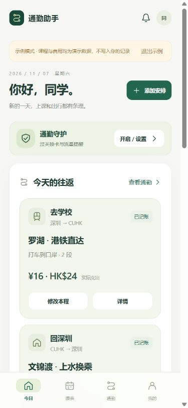
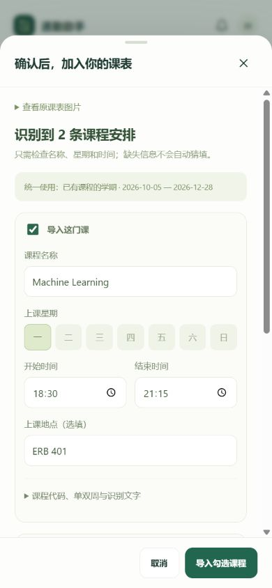
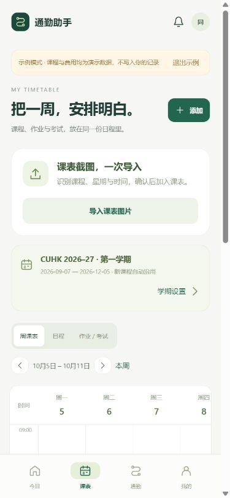
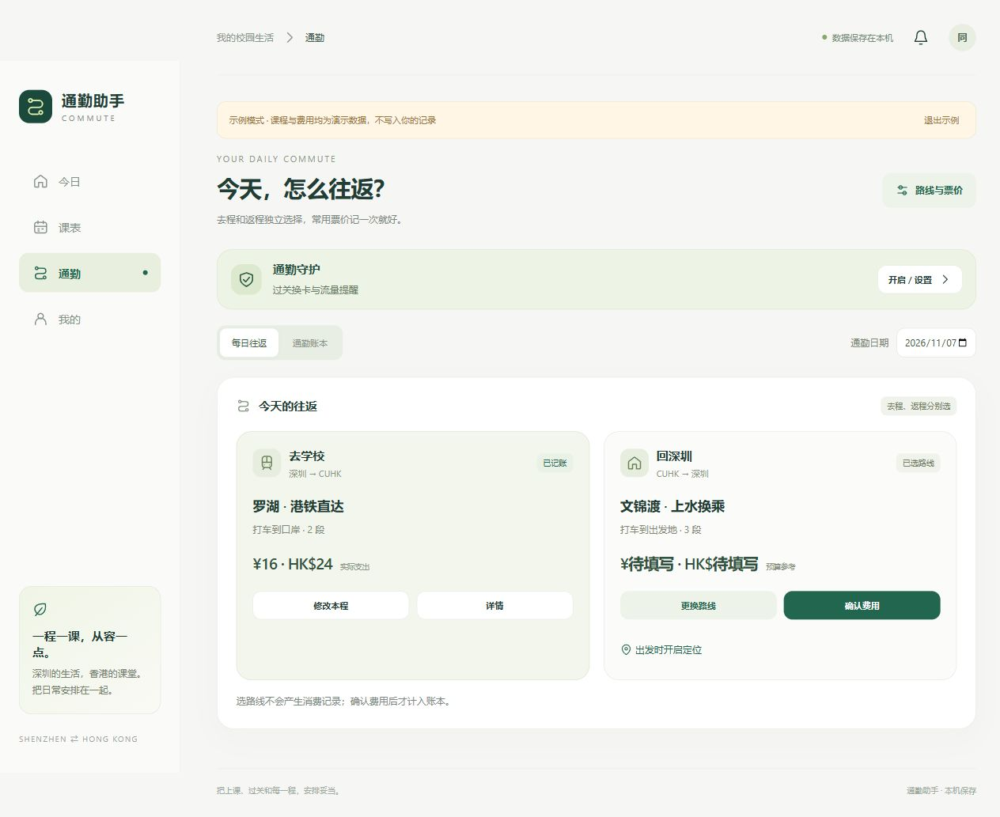

# 通勤助手 · COMMUTE

课程表、作业考试、深港往返记账和换卡守护，放进同一个离线 Android 应用。

**最新版：Android 2.1.4（Android 8+，建议使用新版 System WebView）。**

[下载通勤助手 APK](https://raw.githubusercontent.com/KrysT4L75/Shenzhen-HK-simChange/main/packages/通勤助手-2.1.4.apk) · [源码包](packages/通勤助手-2.1.4-源码.zip) · [校验值](packages/SHA256.txt) · [本次验证](docs/verification-2.1.4.md)

## 2.1.4 更新

课表页优先展示课程；截图导入、学期设置移至右上角「管理」。手机按天展示本周课程卡片，桌面保留周网格；通勤页先展示往返安排。统一卡片、内层面板和按钮圆角，提高正文、辅助信息与触控按钮的字号和尺寸。保留 2.1.3 的 APK 资源路径修复。

## 2.1：尽量少填写

### 课表图片导入

在「课表 → 导入课表图片」选择截图，应用在本机识别课程名、代码、星期、时间和教室，生成可以修改的预览，勾选后批量导入。支持英文、简体中文和繁体中文；也可以直接粘贴课表文字。图片与识别模型不需要上传到服务器。

识别结果需确认，缺少的时间不会自动猜填。网格课表会尝试依据星期列归属课程；只画色块、没有可辨认时间文字的图片，仍需要补充时间。重复课程按课程代码／名称、星期、时间及学期范围去重。

### 学期统一设置

「课表 → 学期设置」选择学期，一次填好起止日期；新建和导入的课程直接沿用。也可同步当前学期已有的课程，单独设置日期的课程保留自身安排。

内置 CUHK 2026–27 第一学期、第二学期与暑期预设，依据[研究生院工程学院校历（含 MSc AI）](https://www.gs.cuhk.edu.hk/download/2627_TDPP_ERG.pdf)。预设不是自动跟踪校历更新；特殊安排或其他学年可调整日期。手工添加课程只要求名称、星期和时间，地点、代码、老师等收进选填项。

### 每天分别选去程和返程

首页点击“开始通勤”后选择去学校或回深圳；通勤页保留每日往返安排。每程独立选择：

1. 经过哪个口岸：罗湖、文锦渡或自定义口岸。
2. 香港段怎么走：港铁直达、上水出站再入闸、文锦渡巴士接驳等。
3. 深圳段用什么交通：打车、公交、地铁、步行或其他。

例如早上走罗湖直达，晚上走文锦渡；更换返程不会改动去程。支持「沿用上次」和「这程不出行」。路线模板用于维护路段和票价，不再作为固定往返组合。

选择路线仅保存安排，不记成消费。到达后点「确认费用」：已设置的固定票价自动带入，打车范围提供快捷金额，首次填写的固定票价可记住，下次少填。人民币和港币分开统计，空白是待补，0 是免费。打车实付金额不会覆盖原有预算范围。

### 通勤守护直接可见

首页显示换卡守护状态；通勤页和行程详情保留「通勤守护」入口，可进入原有换卡设置。已选行程还可以点「出发时开启定位」，继续使用原来的位置节点记录；也可直接确认费用，不强制先启动行程。

## 界面

截图来自同一离线前端的浏览器预览，使用示例数据，不是真机截图。

<p>
  
  
  
</p>



## 其他功能

- 课程周视图、日程视图、单双周、课程冲突提示。
- 关联课程的作业、考试、完成状态和提前通知；日程按 UTC+8 处理。
- 可编辑路线、分段预算、补记／修改历史和月度双币种账本。
- 原网络地区与双卡监测、口岸接近提示、数据卡设置入口。
- JSON 备份与恢复，兼容 2.0 的课程和消费记录；示例模式与自己的数据隔离。

## 安装与升级

在 Android 手机上下载上方 APK 安装。2.1 延续 `cn.shenlink.guard` 包名及原签名，可从同签名的 1.x／2.0 覆盖升级，建议先不要卸载旧版。图片 OCR 的代码和语言模型已包含在包中，安装包比 2.0 大。

固定票价来自用户设置。¥15–17 打车和 ¥1.6 公交只是需求示例，其他未提供价格保持待填写；没有接入港铁实时票价、八达通或支付账户。

## 本地开发

```powershell
# Windows PowerShell，安装 Node.js 22+ 后
./setup-tools.ps1
./build.ps1

# 浏览器预览，数据保存在当前浏览器；demo 模式不保存
node preview/server.cjs
# http://127.0.0.1:4178/?demo=1

# 课程、导入、费用与往返逻辑测试
node --test tests/domain.test.cjs tests/flows.test.cjs
```

`app/src/main/assets/` 包含离线前端；`flows.js` 管理共享学期和每日往返，`timetable-import.js` 提取 OCR 课程，`flows-ui.js` 提供录入流程。`vendor/ocr/` 为固定版本的 Tesseract.js、WebAssembly 引擎和模型；许可证见 [第三方说明](THIRD_PARTY_NOTICES.md)。Android 通过本机资源拦截提供 HTTPS 同源地址，不发送网络请求。

构建输出为 `dist/通勤助手-2.1.4.apk`。签名密钥与密码仅在本机 `.signing/`，不会进入 GitHub 或源码包。`ios/` 保留旧版换卡提醒 SwiftUI 源码，本次未提供 iOS 综合版。

## 验证与使用范围

本地构建与 APK 签名校验通过；56 项 Java 规则断言和 27 组前端数据测试通过。浏览器已实测图片 OCR → 预览 → 导入、统一学期同步、去程罗湖／返程文锦渡选择和独立记账。

2.1 尚未在 Android 真机或模拟器运行。原生图片选择器、WebView 中的 OCR、系统后台通知、定位与覆盖升级仍需设备实测。清晰的列表截图已验证；不同课程系统版式、繁体中文和低清图片的识别效果没有做全面评估。

位置记录仅辅助判断接近口岸、上水和大学站，无法可靠区分出租车和公交，也不能证明实际出入闸。应用不会自动切换 SIM；作业考试提醒采用非精确系统调度，受系统权限和省电策略影响。

应用无联网权限、账户或广告。图片仅在导入期间处理，不写入课表备份；课程、消费、路线和有限位置节点保存在本机，由用户自行导出。
