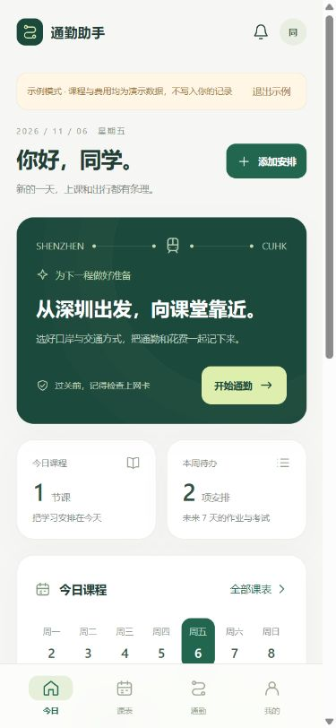
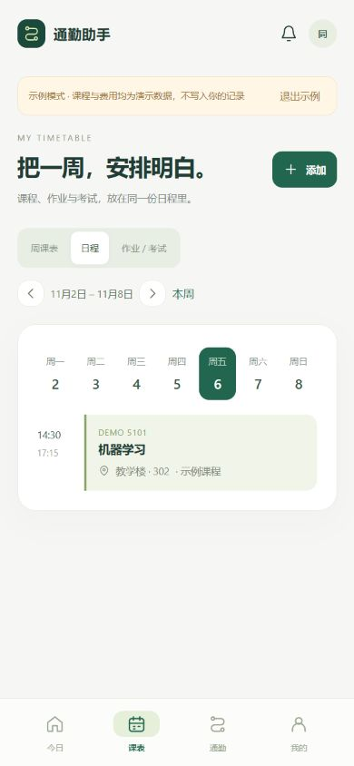
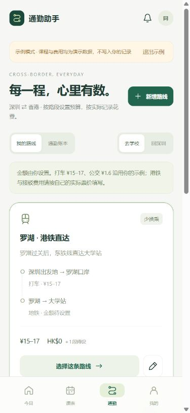

# 通勤助手 · COMMUTE

把上课、DDL、跨境通勤和换卡提醒放进同一个日常工具。面向往返深圳与香港的同学，内置罗湖、文锦渡至 CUHK 大学站的可编辑路线。

**Android 2.0.0 已编译并签名，支持 Android 8+。** 首页采用浅鼠尾草绿、深绿色主卡片与底部四栏导航；平板和电脑预览切换为侧栏布局。

[下载 Android 2.0.0 APK](https://raw.githubusercontent.com/KrysT4L75/Shenzhen-HK-simChange/main/packages/通勤助手-2.0.0.apk) · [下载源码包](packages/通勤助手-2.0.0-源码.zip) · [SHA-256](packages/SHA256.txt) · [验证记录](docs/verification-2.0.0.md)

## 界面预览

以下是浏览器中运行同一套离线前端的手机尺寸截图，使用隔离的示例数据，不是 Android 真机截图。

<p>
  
  
  
</p>

## 四个页面

| 页面 | 可以做什么 |
|---|---|
| 今日 | 下一节课、当天课程、近期作业与考试、月度通勤支出、换卡守护入口 |
| 课表 | 手动增删改课程、星期与起止时间、学期日期、单双周、地点和颜色；周视图与日程视图；作业和考试关联课程、截止时间、完成状态与提前提醒 |
| 通勤 | 保存常用路线与各段预算；选择去学校或回深圳；开始行程、结束确认实际金额、补记与编辑历史；人民币和港币独立统计 |
| 我的 | 昵称、换卡守护、定位偏好、通知设置、JSON 导入导出、隔离的示例模式 |

所有课程和日程按 **UTC+8** 保存和展示。初次使用没有预填的个人课表或消费记录；截图中的课程、考试和历史费用均为演示。

## 通勤与记账

内置三条可编辑路线：

- **罗湖 · 港铁直达**：深圳出发地 → 罗湖口岸 → 大学站。
- **罗湖 · 上水出站再入站**：到罗湖 → 罗湖至上水 → 上水至大学站，分段记账。
- **文锦渡 · 上水换乘**：打车到文锦渡 → 巴士接驳上水 → 港铁到大学站。

到口岸可以选择打车、公交、地铁、步行或其他方式，并分别保存预设金额。例如打车 ¥15–17、公交 ¥1.6；这些数值来自需求中的示例，**不是实时票价**。未提供的港铁和接驳费用保持“待设置”，可按自己的八达通、优惠或支付记录填写。文锦渡路线预设打车到口岸，仍可自行编辑。

预算支持范围，实际支出按每段确认，空白表示待补，0 表示免费。正在进行的行程不会计入月度已发生支出。人民币与港币分别显示，不套用未经确认的汇率。返程反转路段顺序，沿用预算，结束时可以调整金额。

开始行程后，可自愿开启定位。定位模块尝试记录“接近罗湖／文锦渡／上水／大学站”的节点与时间；需两次有效位置确认。**目前不会自动区分打车和公交，也不能确认上水是否实际出闸、重新入闸。** 使用者选择的路线、交通方式与实际费用始终可修正。未连接八达通、支付账单或实时交通票价服务。

## 换卡守护

原“过关换卡”功能保留在「今日」和「我的」入口中，继续使用原有的双卡偏好、网络地区监测、口岸接近提示和系统数据卡设置快捷入口。支持原来的罗湖、福田／落马洲支线、深圳湾、皇岗、莲塘／香园围、文锦渡、沙头角选项。

提醒不能代替系统自动切卡或断网。通勤定位与 SIM 守护分别开启，使用课程表和手工记账不需要电话或位置权限。

## 安装与开始使用

1. 在 Android 手机上下载并安装上方 APK；系统询问时允许当前下载来源安装此包。
2. 已装本仓库 1.2.0 的用户可使用同一签名的 2.0.0 覆盖升级。应用包名仍为 `cn.shenlink.guard`，已有换卡设置继续保留；建议先不要卸载旧版。
3. 在「课表」添加课程，输入上课时间，再添加关联作业或考试。
4. 在「通勤」编辑常用路线和金额，出发时开始一程，到达后确认实际费用。
5. 需要作业／考试通知时，保存提醒并允许通知；需要换卡提示时进入「换卡守护」配置。
6. 在「我的」导出 JSON 备份；导入会在确认后替换当前课表、路线与账本。SIM 守护偏好独立保存在本机，不在此 JSON 内。

## 本地开发与预览

Android 使用 Java 原生壳和本地 WebView 界面，无远程页面、第三方 JS/CDN 或后端依赖。

```powershell
# 需要 Node.js 22+；Android 工具链由脚本下载并校验
./setup-tools.ps1
./build.ps1

# 浏览器预览，含隔离的示例模式
node preview/server.cjs
# http://127.0.0.1:4178/?demo=1
# http://127.0.0.1:4178/phone

# 单独执行前端数据测试
node --test tests/domain.test.cjs
```

APK 输出到 `dist/通勤助手-2.0.0.apk`。构建脚本会执行原换卡规则检查、位置节点推断检查和前端数据测试，再检查 APK 签名与对齐。浏览器预览支持录入与本地存储；系统定位、后台通知和 SIM 守护只在 Android 包中运行。

| 目录 | 内容 |
|---|---|
| `app/src/main/assets/` | 响应式界面、数据模型、离线交互 |
| `app/src/main/java/` | Android 容器、备份、日程提醒、通勤定位与原换卡服务 |
| `tests/` | 规则和数据测试；`device-smoke.ps1` 为 1.x 历史设备脚本 |
| `preview/` | 仅绑定本机的前端预览服务 |
| `packages/` | 已签名 APK、源码压缩包和校验值 |
| `ios/` | 旧版换卡提醒 SwiftUI 源码，未合并本次 2.0 综合界面 |

## 数据与设备验证范围

数据保存在本机，无账户、广告或联网权限。通勤定位只在主动开启的行程中运行，通知栏可停止，最长 6 小时；保存有限节点与时间，不保存完整轨迹。JSON 备份含个人课程与通勤记录，由用户自行保存。

2.0.0 已通过构建、签名校验、56 项 Java 规则断言及 13 组前端数据测试，并在浏览器中检查手机与桌面布局及主要录入流程。**尚未在 Android 真机或模拟器运行 2.0.0**；定位、厂商后台限制、通知送达、系统键盘与升级保留数据仍需设备验证。作业／考试使用系统非精确提醒，可能因省电、权限或系统调度延迟；口岸与车站坐标为未实地校准的参考点。

建议使用较新的 Android System WebView。`ios/` 仍是原换卡提醒的独立 SwiftUI 源码，未在 Xcode 编译或真机验证，本次未提供 iPhone 安装包。

签名密钥和密码只保存在本机 `.signing/`，不进入 GitHub 或源码包。其他开发者重新生成签名后不能覆盖此安装包，需要自己的发布流程。
